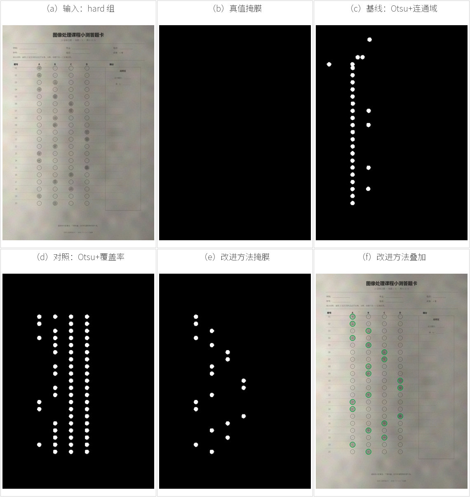

# 答题卡填涂区域自动提取（OMR）

图像处理课程设计：用**全局/局部阈值分割 + 数学形态学 + 选项区域覆盖率**，从一张已经裁切对齐的答题卡中提取被涂黑的选项，输出像素掩膜、每题答案和识别结果。

- GitHub：`https://github.com/<你的用户名>/omr-answer-sheet-segmentation`
- 课程设计报告：[report/图像处理课程设计报告.docx](report/图像处理课程设计报告.docx)
- 对应知识点：全局 Otsu 阈值、局部自适应阈值、数学形态学、连通域分析



## 结果

数据：12 张自建答题卡（4 清晰 / 4 光照不均 / 4 低对比），6 张验证、6 张测试；每张 20 题 × 4 选项，共 240 个填涂、960 个选项气泡。测试集结果：

| 方法 | 像素 F1 | 气泡 F1 | 答案准确率 | 单张耗时 |
|---|---:|---:|---:|---:|
| 基线：全局 Otsu + 连通域 | 0.2705 | 0.3673 | 0.6917 | 88.5 ms |
| 对照：全局 Otsu + 区域覆盖率 | 0.7865 | 0.7229 | 0.8333 | 10.4 ms |
| **改进：局部自适应 + 形态学 + 覆盖率** | **1.0000** | **1.0000** | **1.0000** | 98.6 ms |

> 测试集只有 6 张、且为合成数据，100% 不代表真实照片上的泛化性能。报告第 5 节专门讨论了这一局限。

## 方法

```text
输入灰度图
   ├─ 基线：Otsu 全局阈值 → 连通域 → 面积/长宽比筛选 → 最近气泡匹配
   ├─ 对照：Otsu 全局阈值 → 80 个选项内圆覆盖率 → 阈值判别
   └─ 改进：45×45 均值背景 → 局部差值 → 自适应阈值
                         → 3×3 闭运算/开运算
                         → 80 个选项内圆覆盖率 → 阈值判别
```

改进方法的核心是：用大窗口均值估计慢变的纸面亮度，减去背景后再阈值化，从而消除阴影；闭运算把断裂的铅笔笔画接起来，开运算去掉纸纹和 JPEG 噪点；最后只在半径 15 px 的内圆里统计覆盖率，避开印刷的圆环和字母。

关键代码在 [`src/omr/segmentation.py`](src/omr/segmentation.py)：`predict_baseline_cc` / `predict_global_roi` / `predict_proposed`。

## 数据

`data/` 内是程序化渲染的 12 张答题卡，不是实拍照片：

- 固定版式 1240×1754（A4，150 dpi），20 行 × 4 选项；
- 铅笔填涂用半透明笔迹 + 颗粒模拟，深浅随机；
- 三组退化：清晰、光照不均、低对比/噪声；
- `masks/` 是对应像素级真值，`annotations/` 是每题答案与气泡坐标；
- 生成脚本：[`src/make_dataset.py`](src/make_dataset.py)，固定随机种子 `20261108`，可完全复现。

详细参数和局限见 [`data/README.md`](data/README.md)。

## 快速运行

需要 Python 3.10+，只依赖 NumPy 和 Pillow。

```bash
python -m venv .venv
# Windows
.venv\Scripts\activate
pip install -r requirements.txt

# 重新生成 12 张数据（会覆盖 data/ 下的同名文件）
python src/make_dataset.py

# 跑验证集选参 + 测试集评估，写入 results/
python src/run_experiment.py

# 单张预测
python src/predict.py --image data/images/S01.jpg
```

生成报告插图：

```bash
python src/make_figures.py
```

## 目录

```text
.
├─ src/
│  ├─ omr/                 # 核心算法、数据生成、评价
│  ├─ make_dataset.py      # 生成 12 张数据
│  ├─ run_experiment.py    # 验证/测试评估
│  ├─ predict.py           # 单张预测
│  └─ make_figures.py      # 报告插图
├─ data/                   # 图像、掩膜、标注、索引
├─ results/                # metrics.csv、per_image.csv、summary.md
├─ docs/figures/           # 报告插图
├─ report/                 # 课程设计报告 DOCX
├─ GITHUB登录与上传教程.md
└─ requirements.txt
```

## 适用范围与限制

- 输入必须是**已裁切、已对齐**到 1240×1754 的答题卡；不处理旋转、透视、弯曲和不同版式。
- 数据是合成的，光照/阴影/铅笔纹理都是模拟出来的；真实手机照片还需要增加透视校正、真实纸纹和实拍验证。
- 只支持 20 题 × 4 选项、每题一个答案的固定版式。
- 100% 是“在这个小测试集上”的结果，报告中按清晰/光照/低对比三组分别给出了指标。

## License

代码使用 MIT License，见 [LICENSE](LICENSE)。自建数据仅用于课程设计复现。
